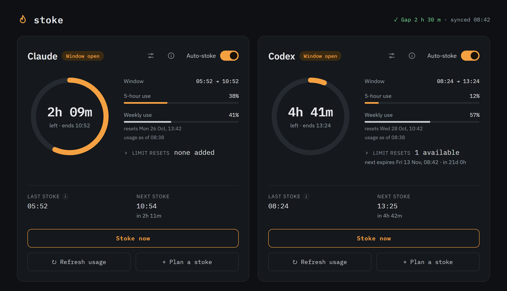

# stoke

Keeps the 5-hour usage window of Claude Code and Codex CLI always running.



> [!NOTE]
> Stoke is an independent project, not affiliated with or endorsed by Anthropic or OpenAI. It only drives the official CLIs the way a user would, but automated use of a subscription may still fall under each provider's terms. Read them and use stoke at your own risk.

## Why

Claude Code and Codex CLI subscriptions meter usage in 5-hour windows. A window starts with your first message and ends 5 hours later, whether you used it or not. If no window is running when you sit down to work, your fresh window starts then, and its reset is 5 hours away.

Stoke sends one tiny message (`hi`) through the official CLI the moment a window ends, so a new one starts right away. When you start working, a window is already running and its reset is never more than 5 hours away. A stoke uses a tiny fraction of the weekly limit; it does not raise any limit, it only moves when windows start.

## Features

| Feature | What it does |
|---|---|
| **Automatic stokes** | One loop per tool: stoke, read the window's end time from the CLI's own output, wait until it ends (+90 s), repeat. Failures back off (1, 5, 15, 30, 60 min). |
| **Panel** | One card per tool: time left in the window, 5-hour and weekly usage, last and next stoke. Auto-stoke switch and **Stoke now** button per tool. |
| **Usage without a message** | **Refresh usage** reads current usage without starting a window (Codex through `codex app-server`, Claude through a separate sign-in). Optional automatic refresh per tool (Settings). |
| **Plans** | Start a tool's window at a chosen local time, once or every day. Automatic stokes pause in the 5 hours before that time so an earlier window does not run into it. |
| **Window offset** | With both tools on, the header shows the gap between their windows and suggests one-click plans that move them 2.5 h apart, so one of them always resets soon. |
| **Limit resets** | Codex reset credits are read and listed with their expiry. Claude's cannot be read; you can enter them by hand as a reminder. Stoke never spends a credit. |
| **Early weekly resets** | When a provider resets the weekly limit early, the panel shows a note and keeps the history (Info). |
| **Warnings** | A short line on the card when something needs attention; see [Warnings](#warnings). |

Only the official, unmodified `claude` and `codex` binaries talk to the providers. Stoke never calls a provider API with your credentials.

## Requirements

| Need | Details |
|---|---|
| **Machine** | Any machine that stays on around the clock: a Raspberry Pi 4 (arm64) or any x86-64 / arm64 Linux box, NAS or server. Stoke stops when the machine sleeps. About 1 GB of disk for the image and ~40 MB of RAM while running. |
| **Docker** | Docker Engine with the Compose plugin **v2.24 or newer** (`docker compose version`), or Docker Desktop. |
| **Accounts** | Claude: a Pro or Max subscription. Codex: a ChatGPT plan that includes Codex. One of the two is enough. |
| **Once, during setup** | A computer with a browser to create the Claude token and approve the sign-ins. |

### Which systems work?

| System | Status |
|---|---|
| Linux (Raspberry Pi OS, Ubuntu, Debian …), amd64 or arm64 | Supported; runs 24/7 on a Raspberry Pi 4. |
| Windows or macOS with Docker Desktop | The panel and dry run work. Real mode should work but is not tested. Stoke only runs while the computer is awake. |
| Without Docker | Not supported. Stoke expects the container's paths and the pinned CLI versions. |

## Installation

### 1. Try it in dry run

Dry run is the default. It never runs either CLI, so no message is sent and no window starts. It shows the panel with simulated windows.

```bash
git clone https://github.com/alpaygun/stoke.git
cd stoke
mkdir data
docker compose up --build
```

Open http://127.0.0.1:8787. The header shows **DRY RUN**. Stop it with `Ctrl+C`, then delete `data/state.json`: it holds the simulated windows, and real mode would otherwise wait for them to end.

> [!IMPORTANT]
> Create the `data` folder yourself before the first start, as the user who runs Docker. If Docker creates it, it belongs to root and stoke cannot save its state. On Linux, stoke runs as uid 1000 inside the container; if your user has a different uid (`id -u`), run `sudo chown 1000:1000 data`.

### 2. Set up real mode

1. **Create the settings file.**

   ```bash
   cp .env.example .env
   ```

   In `.env`, set:
   - `STOKE_DRY_RUN=0`
   - `STOKE_TIMEZONE` to your time zone, for example `Europe/Berlin` or `America/New_York` ([list](https://en.wikipedia.org/wiki/List_of_tz_database_time_zones)). Plan times and the panel's clock use it. Default: `UTC`.
   - `STOKE_TOOLS=claude` or `STOKE_TOOLS=codex` if you use only one of them.
   - `STOKE_AUTO_DEFAULT=0` if you want auto-stoke to start switched off. With the default `1`, stoke sends the first stoke as soon as it starts, unless a window is already known to be running.

   Every setting and its default is listed in [`.env.example`](.env.example). Never commit `.env`.

2. **Claude: create the stoke token.** On any computer with Claude Code installed and a browser, run `claude setup-token` and sign in. Put the token in `.env` as `CLAUDE_CODE_OAUTH_TOKEN=…`. The token is valid for one year; put its expiry date in `STOKE_CLAUDE_TOKEN_EXPIRES=YYYY-MM-DD` and the panel warns you 30 days before it runs out.

3. **Codex: sign in.** First allow device code sign-in in ChatGPT (Settings → Security, device code sign-in for Codex); without it, the approval page shows an error. Then run:

   ```bash
   docker compose run --rm stoke codex login --device-auth
   ```

   Open the link it prints on any device, enter the code and approve. The sign-in is kept in the `codex-home` Docker volume.

4. **Start stoke.**

   ```bash
   docker compose up -d --build
   ```

   Check it: `docker compose ps` shows the container as `healthy` after about 30 seconds, and http://127.0.0.1:8787 shows the panel without the **DRY RUN** badge. `docker compose logs --tail 40 stoke` shows each stoke.

5. **Claude: sign in the usage reader (optional).** The Claude token from step 2 can send messages but cannot read usage. To see Claude's usage without sending a message, sign in a second time with a normal browser login, kept separately in `data/claude-reader`:

   ```bash
   docker compose exec stoke stoke-login claude
   ```

   Follow the instructions it prints to sign in. Stoking works without this step; only **Refresh usage** for Claude needs it.

### 3. Open the panel from other devices

The panel has no login of its own, so it is published on `127.0.0.1` only (`STOKE_PUBLISH_HOST`). Do not publish it on `0.0.0.0` or your LAN address. To reach it from your phone or another computer, put an access layer in front of it, for example:

- a VPN such as Tailscale or WireGuard, or
- Cloudflare Tunnel with Cloudflare Access (sign-in by e-mail). If `cloudflared` runs in another container, set `STOKE_PUBLISH_HOST` to the Docker bridge gateway (usually `172.17.0.1`) and point the tunnel at `http://172.17.0.1:8787`.

Every `POST` request needs the `X-Stoke: 1` header, so another website cannot trigger stokes through your browser.

## Using the panel

- **Auto-stoke** switches the loop on or off for that tool. **Stoke now** sends a stoke immediately.
- **Refresh usage** reads usage without sending a message. **Settings** (the sliders icon on the card) turns automatic refresh on (60 seconds to 24 hours).
- **Info** (the i icon) shows the full text of a warning, the sign-in state and the history of early weekly resets.
- **Plan a stoke** sets a start time. In the 5 hours before it, automatic stokes wait; a manual stoke asks before it skips the plan. A plan is refused if the current window would still be open at that time.
- **Gap** in the header (both tools on auto) opens suggested start times that move the two windows 2.5 h apart.

### Warnings

| Warning | Meaning | What to do |
|---|---|---|
| Auto-stoke stopped | The CLI kept reporting a reset time in the past, so auto-stoke switched itself off. | Switch auto-stoke on or press **Stoke now**. |
| No new window opened | The stoke succeeded but the window did not restart. | Check that the subscription is active. If it keeps happening, the provider may have changed how CLI messages are billed. |
| Limits unreadable | The CLI answered, but stoke could not read the limits from it. | Usually temporary. If it persists after a CLI update, open an issue. |
| Stoke keeps failing | Three or more failures in a row; stoke keeps retrying with backoff. | `docker compose logs stoke` shows the error. Check the token or sign-in. |
| Usage reading signed out | The Claude usage reader's browser login expired. Stoking is not affected. | Run `docker compose exec stoke stoke-login claude` again. |
| Stoke token expires soon | The Claude token from `claude setup-token` expires within 30 days. | Create a new one, update `.env`, run `docker compose up -d`. |

## Updating

**Stoke itself:**

```bash
git pull
docker compose up -d --build
docker image prune -f
```

Your state, plans and sign-ins are kept (`data/` and the `codex-home` volume). Each rebuild leaves the old image behind; `docker image prune -f` removes it.

**The CLIs:** both versions are pinned in the `Dockerfile` (`CLAUDE_CODE_VERSION`, `CODEX_VERSION`) and never update themselves. A stoke release updates them; to try another version, change it there and rebuild.

## Uninstalling

```bash
docker compose down -v
```

This removes the container and the Codex sign-in volume. Then delete the folder, which also removes `.env` (the Claude token) and `data/` (state and the Claude usage reader's sign-in).

## Troubleshooting

| Problem | Fix |
|---|---|
| Compose rejects `env_file` on start | Your Compose is older than v2.24. Update Docker. |
| Permission error on `/data` in the logs | The `data` folder belongs to root. `sudo chown 1000:1000 data`, then `docker compose up -d`. |
| Codex approval page shows an error | Turn on device code sign-in for Codex in ChatGPT's security settings. |
| Times in the panel are off by some hours | Set `STOKE_TIMEZONE` in `.env`, then `docker compose up -d`. |
| Panel unreachable from another device | Expected: it is published on `127.0.0.1` only. See [Open the panel from other devices](#3-open-the-panel-from-other-devices). |

<details>
<summary><strong>How it works</strong></summary>

- One Python process (FastAPI + uvicorn) runs one asyncio loop per tool and serves the panel and a small JSON API. State is a single file, `data/state.json`; there is no database.
- Claude: `claude -p` with the stoke token; the window end comes from the `rate_limit_event` in its `stream-json` output. Usage reads send a `get_usage` control request through the CLI, signed in separately.
- Codex: `codex exec`; the window end comes from the session file the CLI writes. After each stoke the session is removed with the official `codex delete` command, so no history accumulates. Usage and reset credits come from `codex app-server` (`account/rateLimits/read`); the method that spends a credit is never called.
- After a successful stoke the next one is scheduled for the window end + `STOKE_DELAY_SECONDS` (90). On restart, a window that is still running is not stoked again.
- Error messages are cut short and token-like strings are removed before they are stored or shown.

</details>

<details>
<summary><strong>Development</strong></summary>

Python 3.12 or newer.

```bash
python -m venv .venv
.venv/bin/python -m pip install -r requirements-dev.txt     # Windows: .venv\Scripts\python
.venv/bin/python -m pytest -q
```

Tests never run a real CLI. Adding a tool means one file in `src/stoke/providers/` plus one line in its `__init__.py`.

</details>

## License

[MIT](LICENSE)
